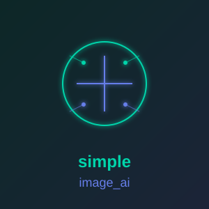

<p align="center">
  
</p>

# simple_image_ai

**[Documentation](https://simple-eiffel.github.io/simple_image_ai/)** | **[GitHub](https://github.com/simple-eiffel/simple_image_ai)**

AI helpers for [simple_image](https://github.com/simple-eiffel/simple_image), running ONNX models through simple_onnx.
Pure Eiffel: no Python at run time.

- **IMG_CUTOUT**: a mask of the people in a photo, from either of two models rembg uses:
  `make` runs `u2net_human_seg` (about 0.3 seconds, but it keeps a chair behind the person),
  `make_portrait` runs BiRefNet-portrait (about 10 seconds on the CPU; leaves the chair out). `mask_for (photo)` gives an IMG_MASK; `cut_out (photo)` gives a copy with the
  background transparent (largest piece kept, color under alpha 0 kept).
- **SIMPLE_IMAGE_AI**: facade: `new_cutout (model_path)`, `new_portrait_cutout (model_path)`,
  `portrait_model_path`, `rembg_model_path`
  (`%USERPROFILE%\.rembg\models\u2net_human_seg\u2net_human_seg.onnx`).

```eiffel
ai: SIMPLE_IMAGE_AI
create ai.make
cutout := ai.new_cutout (ai.rembg_model_path)     -- loads in about 2 seconds; keep it
if cutout.is_ready and then attached cutout.cut_out (photo) as al_person then
	glow := al_person.alpha
	glow.grow (6)
	glow.blur (10)
	canvas.fill_through (glow, 0xFFFFD34D, 0, 0)
	canvas.place (al_person, 0, 0)
else
	print (cutout.last_error)
end
```

## Measured against rembg (2026-10-11)

On a 1920x1080 video frame, the Eiffel mask against rembg's own mask of the same frame:
IoU 0.9997 at 128, mean difference 0.09 levels, largest 8 (edge pixels, from resize
rounding). Time: about 260 milliseconds per frame on the CPU, against 2-3 seconds through
Python.

The model run itself matches Python to 5.4e-7 (debate 01 in simple_image's `.eiffel-workflow`).

## Tests

```bash
/d/prod/ec.sh test -config simple_image_ai.ecf -target simple_image_ai_tests
PATH="/d/prod/simple_onnx/lib/onnxruntime/bin:/d/prod/simple_cairo:$PATH" ./EIFGENs/simple_image_ai_tests/F_code/simple_image_ai.exe
```

The photo tests need a photo of a person at `data/input/person.png` and rembg's mask of it at
`data/expected/person_mask_rembg.png`, made by `.eiffel-workflow/evidence/rembg_reference.py`
(an evidence tool, not product code). Photos are never committed; without them those tests
print SKIPPED.

## Dependencies

simple_image, simple_onnx (with input staged in C memory, 2026-10-11), the ONNX Runtime DLL on
the PATH, and the model file.
